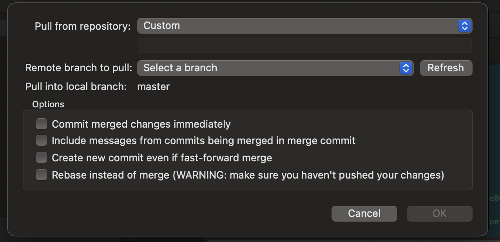

# GL-06 — Окно Pull

**Статус:** Accepted — реализация, mounted/API/Git tests и desktop-приёмка завершены; [доказательства и ограничения](evidence/README.md). **Зависимости:** GL-05; расширение remote API и состояния Git-операций для дополнительных опций.

## Layout и взаимодействия

- [x] Открывать modal с repository selector, строкой URL, remote branch selector и Refresh, неизменяемым именем локальной целевой ветки, блоком Options и нижними Cancel / Pull.
- [x] Repository selector содержит настроенные remotes. Custom из референса требует отдельной поддержки URL и проверки ввода; до этого вариант недоступен с объяснением. URL отображать без раскрытия встроенных credentials.
- [x] Загружать список веток выбранного remote; Refresh обновляет список, выбор remote отменяет/игнорирует старый ответ. Явные loading/empty/auth/error states.
- [x] Показать опции: немедленный commit merge; включение сообщений объединяемых коммитов; отдельный merge commit при fast-forward; rebase вместо merge.
- [x] При выборе rebase отключать merge-only опции и не отправлять сохранённые скрытые значения. Текст кратко объясняет изменение локальной истории.
- [x] Не копировать unchecked defaults со снимка. Явно определить initial values из поддержанной стратегии/настроек репозитория; пользователь видит фактическую стратегию до запуска.
- [x] Primary action доступен только при валидной паре remote/branch, допустимом текущем состоянии и поддержанных опциях. До выполнения повторно проверить repo/HEAD/целевую ветку.
- [x] Escape/Cancel до запуска закрывает окно без Git-мутации. Во время операции есть progress и Cancel operation; закрытие UI не означает успешной отмены процесса.

## Git-зависимости, обязательные для рабочих опций

- [x] Добавить query remote heads (существующего remote tags API недостаточно), типизированные pull options и проверенные формы native argv.
- [x] Определить mapping commit/no-commit, log/no-log, no-ff и rebase; не полагаться на случайные глобальные настройки. Проверить взаимные ограничения.
- [x] Режим без commit может оставить merge незавершённым; fast-forward не создаёт merge commit даже при no-commit. Реальный результат показать в Changes и состоянии репозитория.
- [x] Rebase/merge conflicts, continue/abort и восстановление после перезапуска требуют отдельного механизма операций. Пока его нет, соответствующие новые опции заблокированы и полная задача остаётся открытой.
- [x] Операцию проводить через существующую авторизацию, pre-git guard, mutation queue, отмену и refresh pipeline. Ошибка и отмена после начала требуют перечитать Git-состояние.

## Приёмка

- [x] Desktop visual acceptance: состав/порядок полей и длинные URL/refs проверить в GL-08. Focus trap и возврат фокуса к Pull проверены mounted-тестами.
- [x] Cancel до запуска не меняет repo. Смена HEAD при открытом окне блокирует применение старого запроса либо требует его повторного просмотра.
- [x] На локальном тестовом remote проверены обычный pull, diverged branches, rebase, no-commit/no-ff, auth/error/cancel; не реализованные варианты явно отмечены blocked.
- [x] Результат подтверждён Git, отсутствуют неработающие переключатели, выдающие успешный результат.

## Выполнено в GL-06

- Начальная стратегия явно задана как merge с немедленным commit, без log и без принудительного merge commit. Аргументы `--no-rebase`, commit/no-commit, log/no-log, ff/no-ff, `--no-edit` и `--no-autostash` фиксируют фактическое поведение независимо от настроек стратегии. Rebase отправляет только rebase/no-autostash.
- Remote heads используют существующий авторизованный runner; смена remote/Refresh/закрытие отменяет probe и отбрасывает поздние результаты. Custom URL объяснимо недоступен.
- Снимок полного HEAD и локальной ветки проверяется после save guard и непосредственно внутри очереди перед каждым spawn/retry. Перед фактическим запуском callback также проверяет принадлежность workspace. Handle отмены появляется только при запуске процесса.
- Незавершённые merge/rebase определяются по реальным Git markers в абсолютном Git directory, включая linked worktrees, и конфликтам индекса. Повторное открытие представления восстанавливает Continue/Abort без сохранения собственного operation journal. Ошибка чтения блокирует Pull, а не означает отсутствие операции.
- Continue/Abort проходят save guard, mutation queue и отмену. Merge/rebase используют ограниченные native argv и существующее сообщение без внешнего editor. После начала, ошибки и отмены перечитывается состояние, pending merge/conflicts открывают Changes. Autostash не применяется поверх незавершённой операции; он остаётся доступен для ручного восстановления после recovery.
- Проверки: временные локальные remotes покрывают fast-forward, divergence/log, rebase, no-commit/no-ff и no-commit fast-forward, merge/rebase conflicts с continue/abort, HEAD snapshot и linked worktree. Mounted-тесты покрывают поля/defaults/focus, stale heads, loading/empty/auth/error, закрытие и отмену, save guard, pending merge/stash, recovery/remount и смену HEAD/workspace. Auth/cancel сценарии проверены управляемыми ответами runner; реальные сетевые аккаунты не использовались.
- Исправлен native read-only allowlist для запроса remote tracking refs дерева навигации; точная форма покрыта native test. Desktop visual acceptance остаётся в GL-08.
