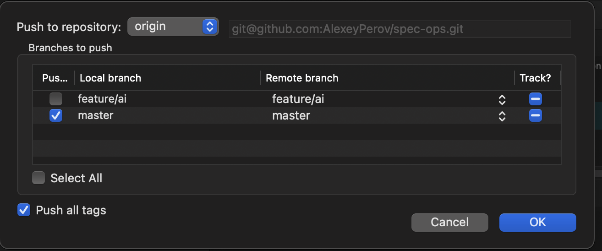

# GL-07 — Окно Push

**Статус:** Implemented UI + exact multi-ref Git plan; desktop visual acceptance pending GL-08. **Зависимости:** GL-05; расширение push API и native contract для нескольких refspec и tracking.

## Layout и взаимодействия

- [x] Открывать modal с remote selector и URL, группой Branches to push, таблицей Push / Local branch / Remote branch / Track, Select all, Push all tags и нижними Cancel / Push.
- [x] Каждая локальная ветка имеет независимый checkbox, редактируемую удалённую цель и явное tracking-состояние. Не трактовать значок с минусом на снимке как готовую семантику: SpecOps показывает понятные track / do not change и текущее upstream отдельно.
- [x] По умолчанию выбирать текущую ветку при допустимом HEAD; целевую удалённую ветку выводить из upstream выбранного remote, иначе явно предлагать одноимённую ветку.
- [x] Push all tags по умолчанию выключен; значение на референсе не является требованием автоматически отправлять все теги.
- [x] Select all действует на строки веток, не включает теги. Изменение remote пересчитывает удалённые refs и tracking, не использует назначения старого remote.
- [x] Поддержать длинные имена, внутренний скролл, loading/empty/auth/error states. Проверять ref names, пустые назначения и дублирующиеся удалённые цели до запуска.
- [x] Primary action требует хотя бы одну выбранную ветку или явный режим tags-only. Detached HEAD не подставляется скрыто вместо выбранной ветки.
- [x] Escape/Cancel до запуска закрывает окно без мутации. Выполнение показывает progress, итог по refs и Cancel operation; повторная отправка во время busy исключена.

## Git-зависимости, обязательные для рабочих контролов

- [x] Добавить типизированный push plan: remote, список точных source SHA/local refs → destination refs, tracking и tags; перепроверять источники перед выполнением, не заменять все строки на HEAD.
- [x] Расширить существующий push одного target на несколько refspec. Определить per-ref результат и частичный успех; атомарность не обещать без подтверждённой поддержки сервера.
- [x] Настраивать upstream только для успешно отправленных веток с выбранным Track; не перепривязывать остальные локальные ветки. Проверить допустимые native config/branch формы, поскольку текущие config/remote формы ограничены.
- [x] Push all tags — самостоятельная явная операция/часть плана; сообщение об успехе отражает ошибки отдельных refs/тегов. Не добавлять force или удаления refs в layout-задачу.
- [x] Сохранить авторизацию, очередь, отмену и refresh; после ошибки/отмены перечитать фактические remote/local tracking states, не повторять возможно выполненный push автоматически.

## Приёмка

- [ ] Desktop visual acceptance: таблица и группы, длинные имена и реальные размеры окна проверяются в GL-08. Tab order, выбор и возврат фокуса проверены mounted-тестами.
- [x] На временном локальном bare remote проверены одна/несколько веток, новое имя назначения, track on/off, tags-only и branches+tags.
- [x] Проверены отказ non-fast-forward, частичный успех и отмена; диалог не сообщает общий успех при отклонённом ref.
- [x] До закрытия Git-зависимостей layout можно принять отдельно, но задачу целиком нельзя отметить Done.

## Проверки реализации

- Typed plan фиксирует SHA каждой выбранной ветки и каждого явно включённого тега. Guard внутри mutation queue перепроверяет source refs непосредственно перед spawn; refspec использует сохранённый SHA, без подстановки HEAD. Новые теги после snapshot требуют Refresh.
- Porcelain-результат хранится для каждого destination; неизвестные результаты после сбоя не считаются успехом. Поддержка atomic server не заявляется. Tracking меняется только для подтверждённо успешных выбранных веток через ограниченные `config --local branch.<name>.remote/merge`; при прерывании оставшаяся настройка прекращается с явным сообщением.
- Temporary local bare remotes: одна/несколько веток с разными SHA, переименование назначения, Track on/off, annotated tags, tags-only, branches+tags, non-fast-forward/partial success, stale branch/tag snapshots и queued cancellation. Native runner дополнительно проверен на реальном push и отмене во время локального receive hook с чтением фактического состояния после отмены.
- Mounted tests: поля, defaults, independent Track/Select all/tags, validation, push URL/redaction, stale responses, loading/auth/empty, focus, progress/cancel, preflight/workspace guards и refresh после partial failure. Real network authentication и desktop screenshot comparison остаются за пределами этого шага.
