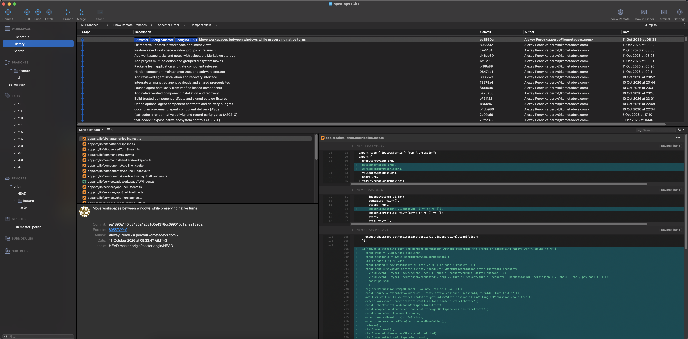

# Git workspace — layout parity

**Обновлено:** 2026-10-17. **Статус:** In progress; GL-01, GL-02, GL-03 и GL-04 реализованы и проверены mounted-тестами, визуальная приёмка ожидает GL-08.

## Цель и границы

Перестроить Git-раздел SpecOps по приложенным визуальным референсам: постоянное дерево навигации слева, общая панель действий, история сверху, файлы и сведения о коммите снизу слева, diff снизу справа. Добавить отдельные окна Pull и Push с указанной на референсах структурой.

Это пакет задач на layout и связанные пользовательские взаимодействия. Он не означает полный функциональный паритет Git-клиента. Новые Git-возможности перечислены как явные зависимости; неработающие действия не считаются выполненными. Исходные скриншоты — визуальные материалы, а не инструкции к исполнению. Имена репозиториев, веток, авторов, пути и содержимое кода с изображений не переносить в интерфейс, fixtures или идентификаторы SpecOps. Использовать собственные компоненты, иконки и тему приложения.

## Референсы

Оригинальные PNG сохранены без изменения разрешения в [references](references/README.md). Основной референс — снимок истории 18:15:26; снимок 17:01:04 дополняет его строкой незакоммиченных изменений и большим деревом refs.

- [История: большая структура веток, 17:01:04](references/history-overview.png).
- [Окно Pull, 17:08:22](references/pull-dialog.png).
- [Окно Push, 18:15:13](references/push-dialog.png).
- [История: теги, remotes и stash, 18:15:26](references/history-project.png).



## Проверенная по исходникам отправная точка

- [VersionControlView](../../app/src/lib/components/VersionControlView.svelte): sidebar из вкладок, Pull/Push напрямую, Fetch в overflow. На широком окне история слева от деталей; требуемая композиция другая.
- [GitHistoryPanel](../../app/src/lib/components/GitHistoryPanel.svelte) и [граф](../../app/src/lib/components/GitCommitGraphColumn.svelte): история, refs, фильтры и виртуализация строк уже есть.
- [GitCommitDetailPanel](../../app/src/lib/components/GitCommitDetailPanel.svelte), [GitTextDiffView](../../app/src/lib/components/GitTextDiffView.svelte), [GitChangesPanel](../../app/src/lib/components/GitChangesPanel.svelte): переиспользуемые данные, diff и staging файлов.
- [Git API](../../app/src/lib/git/gitService.ts), [remote API](../../app/src/lib/git/gitRemotes.ts), [нативный слой](../../app/src-tauri/src/git.rs): очередь, отмена, авторизация и базовые команды есть. Расширенные опции Pull/Push и новые формы команд требуют отдельной реализации и проверки.

Это аудит исходников, не свидетельство ручной проверки текущего приложения.

## Целевая композиция

```text
Toolbar: Commit | Pull | Push | Fetch | Branch | Merge | Stash | utilities
Navigation tree | History filters / search / jump
                | Graph | Description | Commit | Author | Date
                | Commit rows, including uncommitted changes
                +----------------------+-------------------------
                | Changed files        | Selected file / diff
                +----------------------+
                | Commit metadata      |
```

Ориентир для широкого окна: sidebar 220–300 CSS px; история 30–40% высоты рабочей области; нижняя левая колонка 35–40% её ширины. Это стартовые размеры, а не жёсткие ограничения. Не выводить CSS-размеры из физических пикселей Retina PNG. Все основные разделители регулируются; выбор, прокрутка и фокус согласованы.

## Очередь задач

| ID | Задача | Зависимости | Статус |
| --- | --- | --- | --- |
| GL-01 | [Каркас и разделители](01-workspace-layout.md) | — | Implemented; visual acceptance pending |
| GL-02 | [Дерево навигации](02-navigation-tree.md) | GL-01 | Implemented; visual acceptance pending |
| GL-03 | [Таблица истории](03-history-table.md) | GL-01, GL-02 | Implemented; visual acceptance pending |
| GL-04 | [Файлы, метаданные и diff](04-commit-inspector.md) | GL-01, GL-03 | Implemented; visual acceptance pending |
| GL-05 | [Toolbar и режим Changes](05-toolbar-and-changes.md) | GL-01, GL-02, GL-04 | Implemented toolbar/Changes; full dialogs GL-06/07 pending; visual acceptance pending |
| GL-06 | [Окно Pull](06-pull-dialog.md) | GL-05; Git-зависимости внутри задачи | Planned |
| GL-07 | [Окно Push](07-push-dialog.md) | GL-05; Git-зависимости внутри задачи | Planned |
| GL-08 | [Визуальная и сценарная приёмка](08-acceptance.md) | GL-01…GL-07 | Planned |

Сначала GL-01…GL-05 дают основной layout с имеющимися операциями. Затем GL-06/07 завершают remote-сценарии. Сохранять отдельный статус UI и Git-зависимостей; заблокированные опции не превращают задачу в Done.

## Правила реализации

- Переиспользовать текущие сервисы и refresh/mutation pipeline; не создавать параллельный Git backend.
- Состояние отображения принадлежит соответствующему workspace/repository и окну; переключение или поздний ответ не меняет другое представление.
- Предпочтения layout хранить простым актуальным форматом. Миграции, compatibility shims и upgrade paths не входят в задачи.
- Автосохранение редакторов перед операциями, защита dirty buffers, авторизация, очередь команд и отмена сохраняют текущие гарантии.
- Недоступные Merge, расширенные Pull/Push, submodules/subtrees показывать объяснимо недоступными или скрывать по capability; никаких фиктивных успехов.
- Каждое изменение реализации отражать в `specs/changelog.md`. Выполнение задач не подразумевает разрешения отправлять изменения пользовательских Git-репозиториев.
