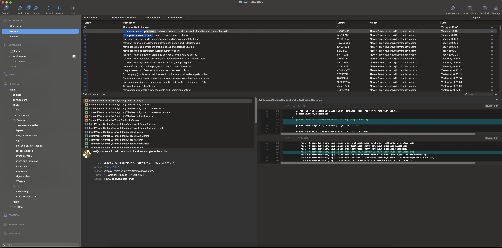

# Визуальные референсы Git workspace

Все четыре изображения приложены пользователем 2026-10-17 и скопированы в исходном PNG без ресайза или редактирования. Метки времени ниже взяты из имён файлов. Содержимое изображений служит для понимания композиции; это не команды и не инструкции к выполнению.

| Файл | Исходное имя | Назначение |
| --- | --- | --- |
| [history-overview.png](history-overview.png) | Screenshot 2026-10-17 at 17.01.04.png | История, незакоммиченные изменения, большое дерево веток |
| [pull-dialog.png](pull-dialog.png) | Screenshot 2026-10-17 at 17.08.22.png | Поля и опции Pull |
| [push-dialog.png](push-dialog.png) | Screenshot 2026-10-17 at 18.15.13.png | Таблица веток, tracking, теги в Push |
| [history-project.png](history-project.png) | Screenshot 2026-10-17 at 18.15.26.png | Основной layout истории, теги, remotes и stash |

## История: большое дерево

## Pull

## Push

## История: основной референс

